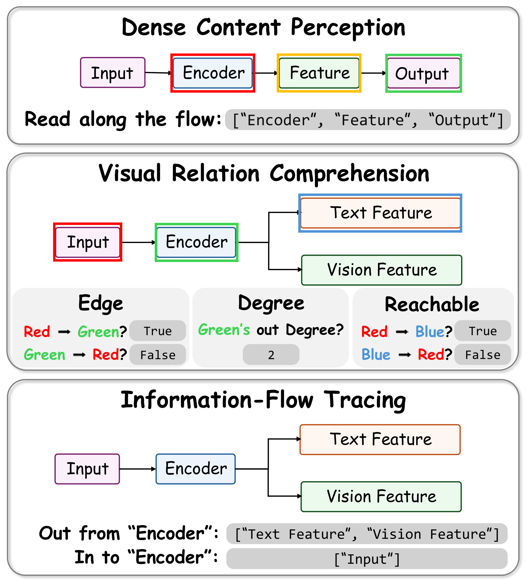

<h1 align="center">🔬 SciFigBench</h1>

<p align="center">
  <a href="https://github.com/LeNcyer/SciFigBench/blob/main/README.md">English</a> · <strong>简体中文</strong> · <a href="https://zhuanlan.zhihu.com/p/2104932244280366850">中文解读</a>
</p>

<p align="center">
  <strong>评估视觉语言模型对论文主图的理解能力。</strong>
</p>

<p align="center">
  <a href="https://github.com/LeNcyer/SciFigBench/blob/main/LICENSE">
  
</a>
  
  <a href="https://arxiv.org/abs/2610.27087">
    
  </a>
  <a href="https://github.com/LeNcyer/SciFigBench/blob/main/assets/SciFigBench%20Poster.pdf">
  
</a>
  <a href="https://huggingface.co/datasets/LeNcyer/SciFigBench">
    
  </a>
  <a href="https://pypi.org/project/scifigbench/">
    
  </a>
</p>

<p align="center">
  <a href="#news">最新动态</a> ·
  <a href="#overview">项目概览</a> ·
  <a href="#quick-start">快速开始</a> ·
  <a href="#license-and-citation">许可证与引用</a>
</p>

---

<a id="news"></a>

## 🔥 最新动态

- **[2026 年 10 月 20 日]** 🎉 **SciFigBench 正式发布！** 经过第二轮人工复核，我们进一步提升了基准的可靠性，并修订了约 5.8% 的参考答案。
- **[2026 年 8 月 21 日]** 🎉 论文 **SciFigBench: A Benchmark for Scientific Method Figure Understanding** 被 **EMNLP 2026 主会**录用！
- **[2026 年 5 月 26 日]** 📝 我们将 SciFigBench 论文投稿至 **2026 年 5 月 ARR**，目标会议为 EMNLP 2026。

<a id="overview"></a>

## 👋 项目概览

**SciFigBench** 是用于评估视觉语言模型（VLM）理解论文主图并进行结构推理的诊断性基准，包含 **4,352 张真实论文主图**和 **40,670 对QA**。基准围绕**密集内容感知**、**视觉关系理解**和**信息流追踪**三项核心能力，设置了五个细粒度任务。

SciFigBench 分别评估文本识别、箭头所表达的结构关系和信息流推理，帮助定位 VLM 理解论文主图时的薄弱环节。

<p align="center">
  
</p>

<p align="center">
  <em>覆盖三项互补能力的五个诊断任务。</em>
</p>

<div align="center">

| 任务 | 评估重点 | 问答对数量 | 指标 |
|---|---|---:|---|
| **密集内容感知** | 识别高亮区域内的文本 | 8,367 | 按位置对齐的 ANLS |
| **边级验证** | 验证节点间的有向边 | 8,665 | 准确率 |
| **节点度数统计** | 统计节点的入边或出边 | 7,848 | 准确率 |
| **路径可达性判断** | 推理有向路径的可达性 | 8,144 | 准确率 |
| **信息流追踪** | 结合文本和连接关系追踪直接邻居 | 7,646 | 基于集合的 ANLS* |
| **合计** | | **40,670** | |

</div>

SciFigBench 还提供经过人工核验的内容与结构标注，供进一步研究使用。完整数据集已发布至 [Hugging Face](https://huggingface.co/datasets/LeNcyer/SciFigBench)。

**答案修订对论文的影响：** 论文使用的是较早版本的问答数据。基于新版答案的评估显示，模型分数变化较小（浮动2%左右），且模型间相对分数的变化保持一致，不影响论文核心结论。

**如果你喜欢我们的项目，欢迎在 GitHub 上点个 Star ⭐！**

<a id="quick-start"></a>

## 🚀 快速开始

Coding Agent使用说明见 [AGENTS.md](https://github.com/LeNcyer/SciFigBench/blob/main/AGENTS.md)。

### 1. 安装

从源码安装 SciFigBench：

```bash
git clone https://github.com/LeNcyer/SciFigBench.git
cd SciFigBench
pip install .
```

通过 PyPI 安装：

```bash
pip install scifigbench
```

### 2. 一键评测

提供你自己的可调用 VLM（`model(prompt=..., image=...) -> str`），SciFigBench 会自动完成数据下载、输入渲染、模型调用和结果评估。

```python
from scifigbench import SciFigBench

model = MyVLM(...)  # 你自己的可调用 VLM

# 快速测试（默认）：每项任务抽取 5 个问答，最多调用模型 25 次。
# 仅为部分样本分数，不是官方完整基准结果。
result = SciFigBench(model=model)
print(result.scores)

# 完整评测：全部 40,670 个问答。
# 注意：可能产生较高的模型 API 费用。
result = SciFigBench(
    model=model,
    max_samples_per_task=None,
    confirm_full_run=True,
)
print(result.scores)
```

高级配置和断点续跑方法见 [AGENTS.md](https://github.com/LeNcyer/SciFigBench/blob/main/AGENTS.md)。

### 3. 下载数据集

数据集托管于 [Hugging Face](https://huggingface.co/datasets/LeNcyer/SciFigBench)。下载最新公开版本的问答数据和图像：

```python
from huggingface_hub import snapshot_download

snapshot_download(
    repo_id="LeNcyer/SciFigBench",
    repo_type="dataset",
    revision="main",  # 最新公开版本；该分支可能发生变化。
    local_dir="./data",
    allow_patterns=["QA/*", "images/*.jpg", "checksums.sha256"],
)
```

也可以使用工具包命令下载：

```bash
scifigbench download --repo-id LeNcyer/SciFigBench --revision main --data-root ./data
```

### 4. 运行你的 VLM

使用你的 VLM 回答基准中的问题。SciFigBench 提供官方提示词和渲染工具，为每个问题生成对应的视觉输入。

```python
import json
from scifigbench import prepare_model_payload

with open("data/QA/qa_edge_level_verification.jsonl", encoding="utf-8") as f:
    qa = json.loads(next(f))

payload = prepare_model_payload(qa, data_root="./data")

# 将 payload["prompt"] 和 payload["image"] 传给你的 VLM。
```

将模型原始回答保存为 JSONL 文件，每行一条预测：

```json
{"qid": "cf32f75bc3d9", "response": "true"}
{"qid": "0aaf24e73a36", "response": "1"}
```

各任务期望的回答格式：

| 任务 | 模型输出格式 |
|---|---|
| 密集内容感知 | 字符串列表的 JSON 文本，顺序与问题中的颜色顺序一致 |
| 边级验证 | `true` 或 `false` |
| 节点度数统计 | 整数文本 |
| 路径可达性判断 | `true` 或 `false` |
| 信息流追踪 | 字符串列表的 JSON 文本 |

### 5. 评估预测结果

使用 SciFigBench 官方指标评估全部五项任务：

```bash
scifigbench evaluate \
    --predictions predictions.jsonl \
    --task all \
    --data-root ./data
```

更多命令和 Python API 说明见 [AGENTS.md](https://github.com/LeNcyer/SciFigBench/blob/main/AGENTS.md)，或运行 `scifigbench --help`。

<a id="license-and-citation"></a>

## ✍️ 许可证与引用

SciFigBench 评测工具包采用 **MIT 许可证**，详见 [LICENSE](https://github.com/LeNcyer/SciFigBench/blob/main/LICENSE)。

如果这个工作对你有所帮助，请使用以下引用：

```bibtex
@inproceedings{wu2026scifigbench,
  title     = {SciFigBench: A Benchmark for Scientific Method Figure Understanding},
  author    = {Wu, Lijia and Li, Zheng and Liu, Yuxuan and Zhang, Jingwen and Zhao, Penghai and Li, Xiang},
  booktitle = {Proceedings of the 2026 Conference on Empirical Methods in Natural Language Processing},
  year      = {2026},
  eprint    = {2610.27087},
  archivePrefix = {arXiv},
  url       = {https://arxiv.org/abs/2610.27087}
}
```
